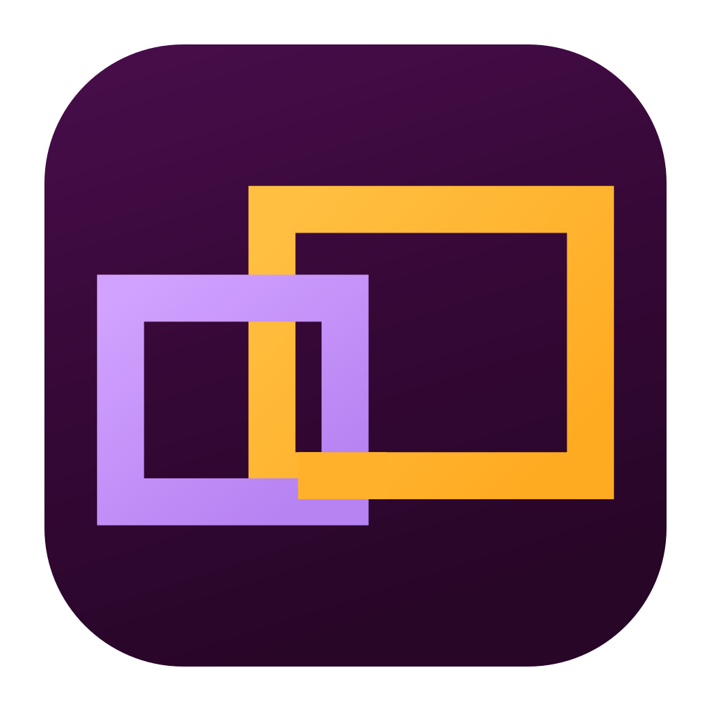

# FrameSync

A small Mac desktop app that sends individual photos or a local folder to one Samsung The Frame TV. Built with Python, Qt Quick/QML, Pillow, and the same [samsungtvws](https://github.com/xchwarze/samsung-tv-ws-api) library credited by [FrameDeck](https://apps.labwyze.com/app/framedeck/).

## Download for Mac

[Download FrameSync for Apple Silicon (ZIP)](https://github.com/kcverde/framesync/releases/latest/download/FrameSync-macOS-arm64.zip). Requires macOS 26 or later. Double-click the ZIP, drag **FrameSync.app** to **Applications**, then open it. Python and Qt are included.

This build uses an ad-hoc signature and has no Apple notarization. If macOS says it cannot verify the developer and you trust this download, open **System Settings → Privacy & Security** and choose **Open Anyway** for FrameSync. [Apple’s first-open instructions](https://support.apple.com/en-us/102445)

## Run from source

Install [uv](https://docs.astral.sh/uv/getting-started/installation/), then run these commands on your Mac:

```sh
git clone https://github.com/kcverde/framesync.git
cd framesync
uv run --locked --python 3.14 framesync
```

Or double-click **Launch FrameSync.command** in Finder.

Use the **◐** button beside the connection status to choose **System**, **Light**, or **Dark**. FrameSync remembers your choice.

### Build the Mac app

On macOS, run these commands from the checkout:

```sh
uv run --locked --group packaging --managed-python --python 3.13 pyinstaller packaging/macos/FrameSync.spec
codesign --verify --deep --strict dist/FrameSync.app
ditto -c -k --sequesterRsrc --keepParent dist/FrameSync.app dist/FrameSync-macOS.zip
```

The build targets the architecture of the Mac running it and uses an ad-hoc signature. Open **dist/FrameSync.app** in Finder or drag it to Applications. Quit the development launcher first, since both versions share the same local settings, pairing tokens, and upload history.

## First sync

1. Put your Mac and TV on the same home network. Display a picture full-screen in Art Mode.
2. Find the TV's IPv4 address in its Network Status settings. Enter it in FrameSync, leave **Secure · 8002** selected, and click **Connect**.
3. Accept the **FrameSync** connection request using the TV remote. Allow local network access on your Mac if prompted. If pairing fails, check the TV's Device Connection Manager permissions. Older models may need **Legacy · 8001**.
4. Choose a folder containing JPG or PNG photos. **Exact 4K · 3840 × 2160** marks a photo at those exact dimensions after orientation, or an applied crop at that output size.
5. Optionally choose **Crop to 4K**. Drag the live 16:9 preview or use the zoom and position sliders, then click **Use 4K crop**. The preview indicates when the result will be upscaled. **Edit crop → Use whole photo** restores the default framing.
6. Click **Sync folder** to send all eligible photos in the chosen folder. For individual photos, use **Add photos…** or drop files from Finder onto **Local photos**. Check the photos you want and click **Send selected**. You can do this without choosing a folder.
7. Open **On the Frame** to see the TV’s thumbnails. Click **Show on Frame** to display a photo. **Now showing** marks the artwork identified by the TV.

## Browse museum artwork

Open **Discover** for 12 featured works from The Met, Cleveland Museum of Art and the Art Institute of Chicago. Choose a museum to browse its highlights or enter a search term to explore its collection. **All featured** restores the mixed selection. Use the source, artist, date, medium and other filters to narrow the results. **♡ Save** keeps a local shortlist in **Saved**. When connected, **On Frame** identifies known imports with confirmed receipts still present on this TV.

Each card shows the downloadable image’s pixel dimensions when available. **Exact 4K** means 3840 × 2160. **4K crop possible** means the image has enough width and height for a full-resolution 16:9 crop. Zooming further in the crop editor can still require enlargement.

Click **Preview & crop…** on a work to open its 16:9 preview. Adjust the framing, then choose **Send to Frame** to upload it to your connected TV. Discover keeps your place and offers **Show on Frame** once the TV confirms that exact crop. This also works for a crop already on the TV. **Save a copy…** exports a 3840 × 2160 JPEG with the same crop and keeps the preview open. Cancelling the preview discards the temporary download. You can preview and save works while disconnected from the TV.

Chicago results use verified public-domain or CC0 reproductions from Wikimedia Commons when available. If an image download fails, FrameSync can open the museum record and import your downloaded copy into the same crop workflow.

Featured previews and your saved list are local. Online collection data and images come from [The Met](https://metmuseum.github.io/), [Cleveland](https://openaccess-api.clevelandart.org/), and [Chicago](https://api.artic.edu/docs/).

## Manage the Frame

- Under **On the Frame**, open an artwork’s **•••** menu to remove it from the TV or open **Artwork settings** for favourites, mattes and photo filters.
- **Remove from Frame** asks for confirmation and preserves the Mac file. Folder sync remembers the removal for that TV and that version of the photo. Select the photo locally and click **Send selected** to restore it.
- Open **Frame settings…** for slideshow playback, brightness, colour temperature, automatic brightness and motion controls. Available choices depend on the TV’s firmware.

## What sync means in v0.1

- Manual, additive sync to one TV. No background watcher, automatic discovery, cloud service, or account.
- Reads JPG/JPEG/PNG files directly inside the chosen folder; ignores subfolders and other formats, including HEIC.
- Converts photos in memory to 3840 × 2160 JPEGs. By default, preserves the whole photo and orientation, adds black borders where needed, and does not enlarge small photos. Originals are never changed.
- Crop choices are saved locally for the file path, modification time, and size. Sync renders each applied crop to a 3840 × 2160 JPEG in memory. Choosing another crop can add another version on the TV.
- Stores a hash of the actual converted image and the TV's returned content ID. Repeat uploads, including renamed copies, are skipped if that ID is still on the TV. Photos uploaded by other apps cannot be deduplicated.
- New or edited photos are added. Folder sync preserves existing TV art and older versions. Removing a local photo does not remove it from the TV.
- Each successful upload is confirmed against the TV's artwork list before the receipt is saved. An uncertain upload stops the run and stays blocked across restarts. Use **Resolve interrupted upload** only after checking the TV and removing any unconfirmed copy; retrying without doing so may create a duplicate.
- Stop finishes the current upload, then stops. Closing during an operation waits for it to finish; close again afterward.
- Settings, pairing tokens, and the SQLite journal live in `~/Library/Application Support/FrameSync`. No photo library is copied there. One instance runs at a time.
- History and tokens are keyed by TV IP. Reserve its address in your router: a changed address is treated as another TV. Do not reuse the old address for another TV without clearing its FrameSync state.

The TV protocol is unofficial and model/firmware dependent. The one-photo workflow was verified on a Samsung QE65LS03FWUXXH in Art Mode. FrameSync reused the saved pairing, uploaded the photo, and matched its receipt to the TV’s artwork list. The photo was also confirmed on screen. On launch, FrameSync tries once to reconnect to the last paired TV and loads its gallery in the background. Click the connection status at the bottom of the sidebar to view or change the TV address and port. If the TV is offline, you can browse Discover or Local photos and click **Retry** later.

On the secure port, first-time pairing opens the remote-control channel and waits up to 60 seconds for approval. It saves the returned token before opening the separate artwork channel. Subsequent connections reuse that token. Blank token files left by an unsuccessful attempt are treated as unpaired. The status distinguishes pairing, opening the artwork channel, and reading the photo library. If the artwork channel fails after approval, try again with the TV in Art Mode; the saved pairing is preserved.

## Development checks

```sh
uv run --locked --python 3.14 python -m unittest discover -s tests -v
```

Tests cover the worker/UI workflow with a fake TV, the library's real handshake code with simulated sockets, token persistence and reuse, denied pairing, artwork-channel failure, legacy connections, repeat sync, missing remote photos, changed photos, cancellation, conversion, independent TV history, and restart recovery after a lost upload confirmation. They do not substitute for a hardware test.

## License and attribution

FrameSync's own code is available under the [MIT License](LICENSE). Bundled fonts use the SIL Open Font License. See the notices for [Asul](src/framesync/fonts/asul-OFL.txt) and [Atkinson Hyperlegible Next](src/framesync/fonts/atkinson-OFL.txt). The [featured artwork catalog](src/framesync/featured/works.json) lists each image's source and public-domain or CC0 designation.

`samsungtvws` is LGPL-3.0; Qt for Python / PySide6 is available under LGPLv3/GPLv3 or a commercial license. Pillow uses the HPND license. The Mac app bundles the shared libraries and includes third-party notices in its Resources directory. This project is independent of Samsung and Labwyze. Review and include the relevant dependency notices before distributing a packaged build.
